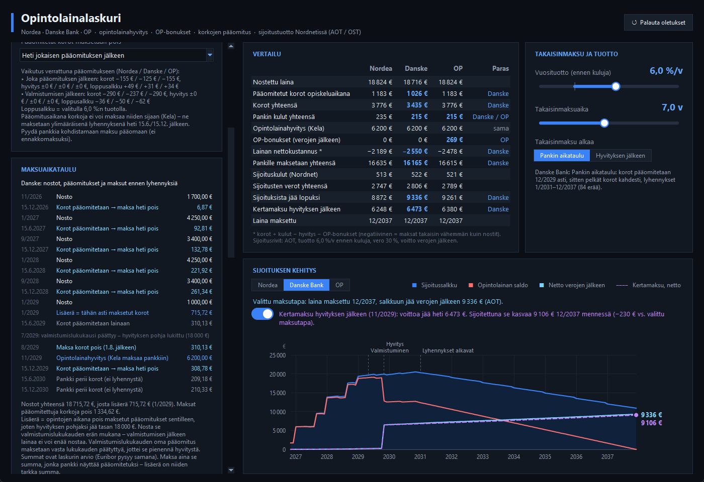

# Opintolainalaskuri

Offline-työpöytäsovellus, jolla vertaillaan Nordean, Danske Bankin ja OP:n opintolainoja. Laskuri ottaa huomioon Kelan opintolainahyvityksen, korkojen pääomituksen ja lainarahojen sijoittamisen Nordnetissä (AOT tai OST).



## Ominaisuudet

- **Pankkivertailu:** Nordean, Danske Bankin ja OP:n korot, kulut, hyvitys ja nettokustannus vierekkäin. Paras pankki merkitään jokaiselle riville.
- **Opintolainahyvitys:** hyvitys lasketaan nostetusta lainasta tutkinnon katon mukaan, ja sen voi kytkeä pois päältä.
- **Nostokatto ja sweet spot:** voit nostaa vain hyvityskaton verran. Sweet spot laskee lisäerän, jolla hyvityksen pohjaksi jää tasan katto, vaikka maksaisit pääomitetut korot pois.
- **Pääomitettujen korkojen maksu:**
  - ei lainkaan
  - kerran vuodessa
  - heti jokaisen pääomituksen jälkeen
  - vasta valmistumislukukauden jälkeen
- **Maksuaikataulu:** jokainen nosto, pääomitus, maksu ja hyvitys päivämäärineen lyhennysten alkuun asti.
- **OP-bonukset:** 0,4 % vuodessa lainasaldosta, 30 %:n ennakonpidätyksen jälkeen.
- **Sijoitukset (Nordnet):**
  - valmiit kohteet, kuten Nordnet Maailma Indeksi, ETF:t sekä suomalaiset ja yhdysvaltalaiset osakkeet
  - kaupankäyntipalkkiot, minimipalkkiot, valuutanvaihto, juoksevat kulut ja osingot
- **Verotus:** AOT- ja OST-tilien ero, FIFO-järjestys, hankintameno-olettama, pienten luovutusten verovapaus ja tappioiden vähentäminen.
- **Takaisinmaksu:** tuottoprosentin ja takaisinmaksuajan säätimet, tasalyhennys tai annuiteetti, sekä vaihtoehto maksaa koko laina kerralla hyvityksen jälkeen.
- **Kuvaaja:** sijoitussalkku, lainan saldo ja nettovarallisuus verojen jälkeen kuukausittain.
- **Muokattavuus:** jokaisen koron, kulun ja oletuksen voi kirjoittaa itse.

## Asennus ja käynnistys

Tarvitset Python 3.8:n tai uudemman, jossa on Tkinter. Pillow 8.2+ on vapaaehtoinen, mutta ilman sitä kuvaaja on karkeampi.

```bash
pip install pillow
```

Käynnistä sovellus:

```bash
python opintolainalaskuri.py
```

Windowsissa voit myös tuplaklikata `Kaynnista.bat`-tiedostoa.

Sovellus toimii täysin ilman verkkoyhteyttä.

### Windows-sovellukseksi (.exe)

`Rakenna_exe.bat` tekee laskurista oman Windows-sovelluksen:

1. **Rakennus:** PyInstaller rakentaa `Opintolainalaskuri.exe`:n kuvakkeella `kuvake/kuvake.ico`.
2. **Asennus:** sovellus kopioidaan kansioon `%LOCALAPPDATA%\Programs\Opintolainalaskuri`.
3. **Pikakuvakkeet:** pikakuvake tehdään työpöydälle ja Käynnistä-valikkoon, joten sovellus löytyy myös Windowsin haulla.

Asenna PyInstaller kerran:

```bash
python -m pip install --user pyinstaller
```

Aja `Rakenna_exe.bat` aina, kun `opintolainalaskuri.py` muuttuu. Sulje sovellus ensin.

Valmis sovellus toimii myös koneissa, joissa ei ole Pythonia. Sen koko on noin 41 Mt.

## Tarkistuslaskelmat

Laske skenaariot ja tarkistukset komentorivillä:

```bash
python tarkistuslaskelmat.py
```

Skripti tekee seuraavat tarkistukset:

- **Dansken esimerkki:** vertaa laskuria Dansken omaan esimerkkilaskelmaan (8 000 €, 15 v, 3,261 %).
- **Maksutavat ja tutkinnot:** laskee pääskenaarion kaikilla maksutavoilla ja tutkinnoilla.
- **Maksuaikataulu:** tarkistaa sweet spot -aikataulun riippumattomalla päivätason laskelmalla.
- **Tilivertailu:** vertaa AOT- ja OST-tilejä sekä kertamaksua pankin aikatauluun.

## Laskennan säännöt

- **Opintolaina:** 850 €/kk. Takaus myönnetään aikaisintaan hakukuukaudesta alkaen, eikä sitä saa takautuvasti.
- **Nostot:** laina nostetaan lukukausittain, ja viimeinen nostopäivä on yleensä 31.7. Valmistumisen jälkeen lainaa ei voi enää nostaa.
- **Korko:** 12 kk Euribor + marginaali. Korko lasketaan todellisista päivistä jakajalla 360.
- **Pääomitus:** korot lisätään lainaan 15.6. ja 15.12. opintotuen ajalta ja vielä yhden lukukauden ajan sen jälkeen. Pääomituksen aikana korkoja ei voi maksaa niiden sijaan. Ne voi maksaa vain ylimääräisenä lyhennyksenä pääomituksen jälkeen.
- **Hyvitys:** 40 % 2 500 € ylittävästä lainasta, katto tutkinnon mukaan. Esimerkiksi 300 op:n tutkinnossa katto on 18 000 € lainaa eli 6 200 € hyvitystä.
- **Hyvityksen pohja:** valmistumislukukauden lopussa jäljellä oleva laina, josta vähennetään kaikki pääomitetut korot (HE 116/2013). Opintojen aikana maksetut korot pienentävät siis pohjaa. Valmistumislukukauden jälkeen maksetut korot eivät pienennä.
- **Takaisinmaksu:** pankki perii viimeisen pääomituksen jälkeen kahdesti pelkät korot, ja sen jälkeen alkavat lyhennykset.

## Esimerkki: Danske Bank, korot pois heti

Oletukset:

- ensimmäinen nosto 11/2026, kolme lukuvuotta ja 300 op:n tutkinto
- Euribor 3,306 % ja Akava-etu (marginaali 0 % viiden vuoden ajan)

Ilman sijoitustuottoa:

| Tapa | Nostot | Korot | Hyvitys | Ero |
|---|---|---|---|---|
| Korot jätetään lainaan | 18 000 € | 3 560 € | 6 200 € | – |
| Korot pois heti + lisäerä 715,72 € (1/2029) | 18 715,72 € | 3 435 € | 6 200 € | +125 € |
| Korot pois heti, ei lisäerää | 18 000 € | 3 358 € | 5 794 € | −204 € |

Lisäerä on sama summa kuin opintojen aikana pois maksetut pääomitukset. Se nostetaan valmistumislukukauden erän mukana. Valmistumislukukauden oma pääomitus (15.6.) maksetaan vasta 1.8. jälkeen.

## Oletusarvot (tarkistettu 2.11.2026)

| | Marginaali | Kulut |
|---|---|---|
| Nordea | 0,50 % | korotus 10 €, 2,50 €/veloitus |
| Danske Bank (Akava-etu) | 0 % 5 v, sen jälkeen 0,50 % | 2,50 €/maksuerä |
| OP (omistaja-asiakas) | n. 0,50 % (ei julkaistu) | 2,50 €/veloitus, bonukset 0,4 %/v |

- **12 kk Euribor:** 3,306 % (30.10.2026).
- **Nordnet:**
  - Helsinki 0,06–0,20 % (min. 3–9 €), Xetra n. 0,20 % (min. 15 €), valuutanvaihto 0,25 %
  - Nordnet Maailma Indeksi: kaupat 0 €, juokseva kulu 0,30 %
- **Verot:** pääomatulovero 30 % (34 % yli 30 000 €).

Korot ja hinnat muuttuvat, joten tarkista omat ehtosi pankista ja Kelasta.

## Lähteet

- [Kela: Opintolaina korkeakoulussa](https://www.kela.fi/opintolaina-korkeakoulussa)
- [Kela: Korkojen pääomittaminen](https://www.kela.fi/yhteistyokumppanit-pankit-korkojen-paaomittaminen)
- [Kela: Opintolainahyvitys](https://www.kela.fi/yhteistyokumppanit-pankit-opintolainahyvitys)
- [HE 116/2013 (opintolainahyvitys)](https://www.edilex.fi/he/20130116)
- [Danske Bank: Opintolaina](https://danskebank.fi/sinulle/lainat/muut/opintolaina)
- [Danske Bank: Usein kysyttyä opintolainasta](https://danskebank.fi/sinulle/asiakaspalvelu/lainat/opintolaina)
- [OP: Keskittämisedut ja bonukset](https://www.op.fi/en/private-customers/customerinfo/consolidation)

## Vastuuvapaus

Laskuri on suuntaa antava apuväline eikä sijoitus- tai lainaneuvontaa. Varmista lopulliset ehdot pankista ja Kelasta.
